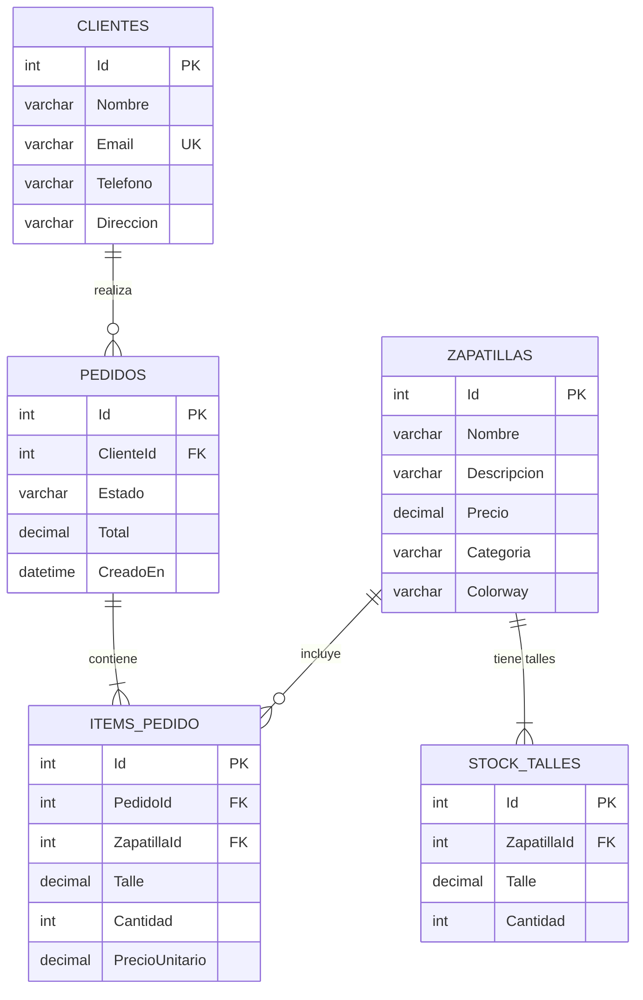

# 👟 APIr Jordan — Tienda de zapatillas Jordan

> Propuesta de proyecto, pensada al mismo nivel que **APIzza** (ASP.NET Core MVC + EF Core + MySQL),
> pero con un dominio distinto: una tienda de zapatillas Jordan.
>
> Nombre: **APIr Jordan** (juego de palabras con *Air Jordan*, igual que APIzza con *pizza*).
>
> **Estado (14/10/2026):** la propuesta ya está implementada en esta carpeta. El alcance final es un poco más amplio
> que el mínimo descrito acá: además de lo listado se hizo **carrito en sesión**, **circuito de estados del pedido**
> (con cancelación que repone stock), **control de concurrencia** sobre el stock, **edición / pausa / eliminación** de modelos,
> **clientes** y un **panel de reportes**. El cronograma real está en `BITACORA.md`; la instalación en `README.md`;
> qué explicar en la defensa en `GUIA_DEFENSA.md`.

---

## Resumen en una frase

Una tienda online de zapatillas Jordan donde se puede recorrer el catálogo por categoría, ver la ficha de
cada modelo con **sus talles disponibles**, cargar modelos nuevos y **hacer una compra** que queda guardada
en MySQL (cliente + pedido + ítems) y **descuenta el stock del talle comprado**.

---

## Equivalencia con APIzza (para ver que es el mismo nivel)

| APIzza | APIr Jordan | Comentario |
|---|---|---|
| `Pizza` | `Zapatilla` (modelo) | Nombre, descripción, precio, categoría, colorway |
| Categoría: clasica / especial / vegetariana | Categoría: **retro / lifestyle / basquet** | Mismo filtro del menú |
| — (no existe) | **`StockTalle`** | **La novedad**: cada modelo tiene talles con cantidad disponible |
| `Cliente` | `Cliente` | Igual (email único) |
| `Pedido` | `Pedido` | Igual, con estados: pendiente / pagado / enviado / entregado |
| `ItemPedido` | `ItemPedido` **+ Talle** | Guarda qué talle se compró |
| `PizzasController` | `ZapatillasController` | Index (filtros, orden, paginación), Detalles, Crear y Editar GET/POST, Pausar, Eliminar |
| `PedidosController` | `CarritoController` + `PedidosController` | Carrito en sesión; Checkout GET/POST, Confirmacion, Index, Detalles, CambiarEstado |
| — | `ClientesController`, `PanelController` | Clientes con historial; panel de reportes |
| `MenuViewModel` | `CatalogoViewModel` | Lista + filtros aplicados + total + páginas |
| `PedidoViewModel` / `LineaPedidoViewModel` | `CarritoViewModel` / `LineaCarritoViewModel` + `CheckoutViewModel` | Las líneas salen de la sesión, no del formulario |
| `PizzaCrearViewModel` | `ZapatillaFormViewModel` (+ `StockTalleFormViewModel`) | Sirve para crear y editar; una celda por talle |
| `Helpers/PizzaImagen` | `Helpers/ZapatillaImagen` + `Helpers/Formato` | Ilustraciones propias; pesos y fechas en es-AR |
| `_TarjetaPizza.cshtml` | `_TarjetaZapatilla.cshtml` + `_Estado.cshtml` | |
| `schema.sql` / `inserts.sql` / `consultas_dbeaver.sql` / `DER/` | `schema.sql` / `inserts.sql` / `consultas.sql` / `DER/` | Una tabla más y más restricciones |

**Lo que hace que no sea "APIzza con otro nombre":** el stock por talle. Una pizza siempre "hay";
una zapatilla se vende **por talle y en cantidad limitada** (drops). Eso agrega una tabla, una regla de negocio
real (no vender sin stock, descontar al confirmar) y una pantalla de ficha con grilla de talles, sin cambiar
la arquitectura ni la dificultad general.

---

## 1. OBJETIVO DEL PROYECTO

### Objetivo general

Desarrollar una aplicación web con arquitectura **MVC** y persistencia en una base de datos relacional
**MySQL** que permita administrar el catálogo, el stock por talle y las ventas de una tienda de zapatillas
Jordan, aplicando los contenidos de la materia: modelado de datos (DER / modelo relacional), SQL, C#,
ASP.NET Core MVC, Entity Framework Core y programación asincrónica.

### Objetivos específicos

1. Modelar la base de datos con **5 tablas relacionadas** (DER + modelo relacional normalizado, PK/FK, UNIQUE, CHECK).
2. Implementar un **catálogo navegable** con filtro por categoría y ficha de detalle de cada modelo.
3. Permitir el **alta de nuevos modelos** desde la web con un formulario validado (DataAnnotations + ModelState).
4. Registrar **compras**: cliente + pedido + ítems, con el precio tomado de la base y el total calculado en el servidor.
5. **Controlar stock por talle**: mostrar solo talles disponibles, rechazar compras sin stock y descontar al confirmar.
6. Documentar el sistema (README, guía de defensa, consultas SQL) y **defenderlo oralmente** con una demo.

### Problema que resuelve / justificación del tema

Una tienda de zapatillas necesita saber, para cada modelo, **qué talles tiene y cuántos pares quedan**.
Hacerlo a mano (planilla / WhatsApp) genera errores: se vende un talle que ya no está, se pierden pedidos,
no hay historial del cliente. El sistema centraliza catálogo, stock y pedidos en una sola base de datos.

### Alcance

| Entra en esta entrega | Queda afuera (posibles mejoras) |
|---|---|
| Inicio con modelos destacados | Pagos reales (MercadoPago) |
| Catálogo con filtro por categoría | Login / usuarios con roles |
| Ficha del modelo con grilla de talles | Carrito persistente en sesión |
| Alta de modelo (con stock inicial por talle) | Envío de emails |
| Compra con talle + cantidad + datos del cliente | Edición / baja de modelos (CRUD completo) |
| Descuento de stock al confirmar | Panel de administración separado |
| Lista y detalle de pedidos | API REST + consumo con `fetch` (ver "Extras") |

---

## 2. CONTENIDOS Y ENTREGABLES OBLIGATORIOS

### Contenidos de la materia que se aplican

| Área | Contenido | Dónde se ve en el proyecto |
|---|---|---|
| **Modelado de datos** | DER, relaciones 1:N, PK/FK, normalización (1FN–3FN), restricciones UNIQUE / CHECK / DEFAULT | `database/DER/`, `database/schema.sql` |
| **SQL** | DDL (CREATE / ALTER), DML (INSERT), consultas con JOIN, GROUP BY, agregaciones | `schema.sql`, `inserts.sql`, `consultas.sql` |
| **POO / C#** | Clases, propiedades, listas, navegación entre objetos, `switch` expressions | `Models/`, `Helpers/` |
| **ASP.NET Core MVC** | Routing, controladores, vistas Razor, layout, partial views, ViewModels, model binding, validación, TempData, patrón Post/Redirect/Get, AntiForgeryToken | `Controllers/`, `Views/`, `ViewModels/` |
| **EF Core** | DbContext, DbSet, Fluent API (`OnModelCreating`), LINQ, `Include` / `ThenInclude`, `SaveChangesAsync` | `Data/ApirJordanDbContext.cs` |
| **Asincronía** | `async` / `await`, `ToListAsync`, `FindAsync`, `FirstOrDefaultAsync` | Todos los controladores |
| **Inyección de dependencias** | DbContext inyectado por constructor, registrado en `Program.cs` | `Program.cs` |
| **Front** | HTML semántico, CSS propio, responsive básico | `Views/`, `wwwroot/css/site.css` |

### Entregables (checklist)

| # | Entregable | Archivo / lugar | Estado |
|---|---|---|---|
| 1 | Documento de propuesta (nombre, objetivo, alcance, DER preliminar, páginas) | `PROPUESTA.md` (este documento) | ✔ |
| 2 | DER + modelo relacional | `database/DER/DER_APIrJordan.mmd` / `.dot` / `.png` / `.svg` | ✔ |
| 3 | Script de estructura | `database/schema.sql` | ✔ |
| 4 | Script de datos iniciales | `database/inserts.sql` | ✔ |
| 5 | Consultas de verificación y reportes (mínimo 6) | `database/consultas.sql` (16) | ✔ |
| 6 | Código fuente en GitHub (solución + proyecto web) | `APIrJordan.sln`, `APIrJordan.Web/` | ✔ |
| 7 | Aplicación funcionando contra MySQL local (demo) | `dotnet run` | ☐ (probar en la máquina de la defensa) |
| 8 | README (instalación, conexión MySQL, páginas, qué se guarda) | `README.md` | ✔ |
| 9 | Guía de defensa (async, MVC, controlador → vista, BD) | `GUIA_DEFENSA.md` | ✔ |
| 10 | Defensa oral + demo en vivo (5–10 min) | — | ☐ |

### Base de datos (5 tablas)



Esquema SQL (borrador de `schema.sql`, mismo estilo que el de APIzza):

```sql
CREATE DATABASE IF NOT EXISTS apirjordan CHARACTER SET utf8mb4 COLLATE utf8mb4_0900_ai_ci;
USE apirjordan;

CREATE TABLE Zapatillas (
    Id          INT NOT NULL AUTO_INCREMENT,
    Nombre      VARCHAR(120) NOT NULL,          -- 'Air Jordan 1 Retro High OG'
    Descripcion VARCHAR(500) NULL,
    Precio      DECIMAL(10,2) NOT NULL,
    Categoria   VARCHAR(30) NOT NULL DEFAULT 'retro',   -- retro | lifestyle | basquet
    Colorway    VARCHAR(80) NULL,               -- 'Chicago', 'Bred', 'Concord'
    PRIMARY KEY (Id),
    INDEX IX_Zapatillas_Categoria (Categoria)
) ENGINE=InnoDB;

CREATE TABLE StockTalles (
    Id          INT NOT NULL AUTO_INCREMENT,
    ZapatillaId INT NOT NULL,
    Talle       DECIMAL(3,1) NOT NULL,          -- 38, 38.5, 39 ... (si querés simplificar: INT sin medios talles)
    Cantidad    INT NOT NULL DEFAULT 0,
    PRIMARY KEY (Id),
    UNIQUE KEY UX_StockTalles_Zapatilla_Talle (ZapatillaId, Talle),
    CONSTRAINT FK_StockTalles_Zapatillas FOREIGN KEY (ZapatillaId) REFERENCES Zapatillas (Id)
        ON DELETE CASCADE ON UPDATE CASCADE,
    CONSTRAINT CK_StockTalles_Cantidad CHECK (Cantidad >= 0)
) ENGINE=InnoDB;

CREATE TABLE Clientes (
    Id        INT NOT NULL AUTO_INCREMENT,
    Nombre    VARCHAR(120) NOT NULL,
    Email     VARCHAR(160) NOT NULL,
    Telefono  VARCHAR(40) NULL,
    Direccion VARCHAR(250) NOT NULL,
    PRIMARY KEY (Id),
    UNIQUE KEY UX_Clientes_Email (Email)
) ENGINE=InnoDB;

CREATE TABLE Pedidos (
    Id        INT NOT NULL AUTO_INCREMENT,
    ClienteId INT NOT NULL,
    Estado    VARCHAR(30) NOT NULL DEFAULT 'pendiente',  -- pendiente | pagado | enviado | entregado
    Total     DECIMAL(10,2) NOT NULL DEFAULT 0.00,
    CreadoEn  DATETIME(6) NOT NULL DEFAULT CURRENT_TIMESTAMP(6),
    PRIMARY KEY (Id),
    CONSTRAINT FK_Pedidos_Clientes FOREIGN KEY (ClienteId) REFERENCES Clientes (Id)
        ON DELETE RESTRICT ON UPDATE CASCADE
) ENGINE=InnoDB;

CREATE TABLE ItemsPedido (
    Id             INT NOT NULL AUTO_INCREMENT,
    PedidoId       INT NOT NULL,
    ZapatillaId    INT NOT NULL,
    Talle          DECIMAL(3,1) NOT NULL,
    Cantidad       INT NOT NULL DEFAULT 1,
    PrecioUnitario DECIMAL(10,2) NOT NULL,     -- histórico: si cambia el precio, el pedido viejo no cambia
    PRIMARY KEY (Id),
    CONSTRAINT FK_ItemsPedido_Pedidos FOREIGN KEY (PedidoId) REFERENCES Pedidos (Id)
        ON DELETE CASCADE ON UPDATE CASCADE,
    CONSTRAINT FK_ItemsPedido_Zapatillas FOREIGN KEY (ZapatillaId) REFERENCES Zapatillas (Id)
        ON DELETE RESTRICT ON UPDATE CASCADE,
    CONSTRAINT CK_ItemsPedido_Cantidad CHECK (Cantidad > 0)
) ENGINE=InnoDB;
```

### Páginas

| URL | Qué hace | Equivalente en APIzza |
|---|---|---|
| `/` | Inicio: hero + destacadas + 3 categorías + novedades + "cómo comprar" | `/` |
| `/Zapatillas` | Catálogo con filtros por categoría, talle con stock, búsqueda, orden y paginación | `/Pizzas` |
| `/Zapatillas/Detalles/1` | Ficha del modelo: precio, colorway, **curva de talles** (los sin stock deshabilitados), agregar al carrito, relacionados | `/Pizzas/Detalles/1` |
| `/Zapatillas/Crear` · `/Zapatillas/Editar/1` | Alta y edición de modelo con stock por talle; pausar y eliminar | `/Pizzas/Crear` |
| `/Carrito` | Carrito en sesión: cantidades, quitar, vaciar, avisos de stock | — |
| `/Pedidos/Checkout` | Datos del cliente + confirmación (descuenta stock en una transacción) | `/Pedidos/Crear` |
| `/Pedidos/Confirmacion/1` | Comprobante del pedido recién creado | — |
| `/Pedidos` | Lista de pedidos con pestañas por estado y búsqueda | `/Pedidos` |
| `/Pedidos/Detalles/1` | Detalle: ítems con talle, línea de tiempo del estado, cambiar estado / cancelar | `/Pedidos/Detalles/1` |
| `/Clientes` · `/Clientes/Detalles/1` | Clientes con totales e historial | — |
| `/Panel` | Reportes: ventas, pedidos por estado, ranking de modelos y talles, stock bajo | — |

### Reglas de negocio (lo que vas a poder explicar en la defensa)

1. **El precio sale de la base**, nunca del formulario (el navegador se puede manipular).
2. **El total se calcula en el servidor** sumando `PrecioUnitario * Cantidad`.
3. **No se vende sin stock**: el `select` solo muestra talles con `Cantidad > 0` y el servidor lo vuelve a verificar en el POST.
4. **Al confirmar se descuenta el stock** del talle comprado, en el mismo `SaveChangesAsync()` que guarda el pedido (todo o nada).
5. **El cliente se reutiliza por email**: si ya compró, se actualizan sus datos; si no, se crea.
6. **`ItemPedido` guarda el talle y el precio del momento** (histórico), aunque después cambie el stock o el precio.
7. **Dos personas no pueden comprar el último par**: `StockTalles.Cantidad` es token de concurrencia; el segundo `UPDATE` falla y se avisa.
8. **Los estados tienen reglas**: pendiente → pagado → enviado → entregado; cancelar solo desde pendiente/pagado y **repone el stock**.
9. **Un modelo vendido no se borra** (FK `RESTRICT`): se pausa y deja de mostrarse.

Flujo del POST `Pedidos/Checkout`:

```text
Formulario (solo datos del comprador) → CheckoutViewModel (model binding + Data Annotations)
  → rearmar las líneas desde la sesión (CarritoService) + la base: stock y precios actuales
  → validar: carrito no vacío, ninguna línea con problema, ModelState válido
  → buscar/crear Cliente por email
  → crear Pedido + ItemsPedido (PrecioUnitario desde la BD, Total en servidor)
  → descontar StockTalles.Cantidad (token de concurrencia)
  → SaveChangesAsync()  (una sola transacción; DbUpdateConcurrencyException → aviso y vuelta al carrito)
  → vaciar carrito + RedirectToAction(Confirmacion)   (Post/Redirect/Get)
```

### Datos de prueba (seed / `inserts.sql`)

Precios de ejemplo en pesos. Cada modelo tiene las 10 filas de la curva (38 a 45, con 40.5 y 42.5); acá se listan los talles con stock.

| Modelo | Colorway | Categoría | Precio | Talles con stock |
|---|---|---|---|---|
| Air Jordan 1 Retro High OG | Chicago | retro | 389.999 | 39, 40, 40.5, 41, 42, 42.5, 43, 44 |
| Air Jordan 4 Retro | Bred Reimagined | retro | 419.999 | 40, 41, 42, 43, 44 |
| Air Jordan 11 Retro | Concord | retro | 449.999 | 41, 42, 43, 45 |
| Air Jordan 3 Retro | White Cement | retro | 399.999 | 40, 41, 42, 44 |
| Air Jordan 12 Retro | Taxi | retro | 429.999 | — (agotada, para mostrar el caso) |
| Air Jordan 1 Low | Bred Toe | lifestyle | 249.999 | 38 a 45 |
| Jordan Spizike Low | White/Black | lifestyle | 299.999 | 40, 42, 43 |
| Jordan Max Aura 6 | Black/Red | lifestyle | 219.999 | 39, 40, 41, 42, 43 |
| Jordan Luka 3 | Motorsport | basquet | 259.999 | 41, 42, 42.5, 43, 44, 45 |
| Jordan Tatum 3 | Zen | basquet | 239.999 | 40, 41, 42, 43 |

Más 3 clientes y 4 pedidos (entregado, enviado, cancelado y pendiente) para que el circuito de estados y el panel tengan datos desde el inicio.

**Imágenes:** ilustraciones propias generadas para el proyecto (sin fotos oficiales de Nike) en `wwwroot/images/zapatillas/`,
más una silueta genérica en SVG para modelos sin ilustración. *Proyecto educativo sin fines comerciales. Jordan y Air Jordan son marcas de sus respectivos dueños.*

### Consultas de `consultas.sql` (16)

1. Catálogo publicado con stock total y talles con stock (`LEFT JOIN` + `GROUP BY`).
2. Curva de talles de un modelo con situación (`CASE`).
3. Filtro del catálogo: modelos con stock en un talle puntual.
4. Pedidos con datos del cliente y pares (subconsulta).
5. Detalle completo de un pedido: modelo, talle, cantidad, subtotal.
6. KPIs del panel: ventas, ticket promedio, pedidos en curso (sin cancelados).
7. Pedidos por estado (`FIELD` para ordenar el circuito).
8. **Ranking de modelos más vendidos**.
9. **Talles más vendidos**.
10. Ventas por categoría.
11. Stock bajo (1 o 2 pares).
12. Modelos **agotados** (`NOT EXISTS`).
13. Clientes con cantidad de pedidos y total gastado.
14. Control de integridad: `Total` del pedido vs. suma de sus líneas (`HAVING`).
15. Transacción de compra escrita a mano (`UPDATE ... WHERE Cantidad >= n` + `INSERT`), con `ROLLBACK`.
16. Cancelación que repone el stock (`UPDATE ... JOIN`), con `ROLLBACK`.

### Estructura de carpetas (la que quedó implementada)

```text
APIrJordan/
├── APIrJordan.sln
├── README.md · PROPUESTA.md · BITACORA.md · GUIA_DEFENSA.md
├── database/
│   ├── schema.sql
│   ├── inserts.sql
│   ├── consultas.sql
│   └── DER/  (DER_APIrJordan.mmd / .dot / .png / .svg)
└── APIrJordan.Web/
    ├── Program.cs
    ├── appsettings.json           (ConnectionStrings:ApirJordanDb)
    ├── Models/                    Zapatilla, StockTalle, Cliente, Pedido, ItemPedido, Categorias, Talles, EstadoPedido
    ├── ViewModels/                Inicio, Catalogo, ZapatillaDetalle, ZapatillaForm, Carrito, Checkout, PedidosIndex, ClienteResumen, Panel, Error
    ├── Data/                      ApirJordanDbContext, SeedData
    ├── Services/                  CarritoService (carrito en sesión)
    ├── Helpers/                   Formato, ZapatillaImagen
    ├── Controllers/               Home, Zapatillas, Carrito, Pedidos, Clientes, Panel
    ├── Views/                     Home/, Zapatillas/, Carrito/, Pedidos/, Clientes/, Panel/, Shared/(_Layout, _TarjetaZapatilla, _Estado)
    └── wwwroot/                   css/site.css, js/site.js, images/zapatillas/*.jpg, fonts/
```

Bosquejo de los dos modelos nuevos (lo demás es igual a APIzza):

```csharp
/// <summary>Un modelo de zapatilla del catálogo.</summary>
public class Zapatilla
{
    public int Id { get; set; }
    public string Nombre { get; set; } = string.Empty;
    public string? Descripcion { get; set; }
    public decimal Precio { get; set; }
    public string Categoria { get; set; } = "retro";   // retro, lifestyle o basquet
    public string? Colorway { get; set; }

    public List<StockTalle> Talles { get; set; } = new();
}

/// <summary>Cuántos pares hay de un talle de un modelo.</summary>
public class StockTalle
{
    public int Id { get; set; }
    public int ZapatillaId { get; set; }
    public Zapatilla? Zapatilla { get; set; }
    public decimal Talle { get; set; }
    public int Cantidad { get; set; }
}
```

---

## 3. MODALIDAD Y HITOS DE SEGUIMIENTO

### Modalidad

- Trabajo **individual** (o en pareja, según lo que indique la cátedra).
- Todo el código en un **repositorio de GitHub** con commits frecuentes y descriptivos (`feat: catálogo con filtros`, `db: tabla StockTalles`, …).
- Cada hito se cierra con un **commit/tag** (`hito-1`, `hito-2`, …) y una **muestra de avance** al docente (2–3 minutos: qué se hizo, qué falta, qué trabó).
- Seguimiento semanal; si un hito se atrasa, se recorta alcance (ver "Extras"), nunca la base de datos ni la compra.

### Cronograma (6 semanas, del 14/10 al 20/11/2026; defensa en la última semana de noviembre)

| Hito | Semana | Qué se entrega / se muestra | Criterio de "listo" |
|---|---|---|---|
| **H0 — Tema y propuesta** | 14–18/10 | Este documento, DER preliminar, solución creada | Propuesta aprobada por el docente |
| **H1 — Base de datos** | 19–25/10 (seguimiento vie 23/10) | `schema.sql`, `inserts.sql`, `consultas.sql` (16 consultas), DER final, `DbContext` | Los 3 scripts corren de punta a punta en MySQL / DBeaver sin errores |
| **H2 — MVC de lectura** | 26/10–1/11 (vie 30/10) | `Models`, `SeedData`, conexión MySQL; Inicio + Catálogo con filtros/orden/paginación + Ficha con curva de talles | Se navega el catálogo con datos reales de la base |
| **H3 — Alta/edición y carrito** | 2–8/11 (vie 6/11) | `Zapatillas/Crear` y `Editar` con stock por talle, pausar/eliminar; carrito en sesión | Un modelo cargado desde la web aparece en el catálogo y en `Zapatillas` / `StockTalles`; el carrito avisa si no hay stock |
| **H4 — Checkout, estados y panel** | 9–15/11 (vie 13/11) | Checkout que guarda Cliente / Pedido / Items y **descuenta stock** en una transacción; estados con cancelación; clientes; panel | Comprar el último par lo deja sin stock; dos compras simultáneas no lo venden dos veces |
| **H5 — Pulido y documentación** | 16–22/11 (vie 20/11) | Páginas de error, responsive, animaciones, README, GUIA_DEFENSA, BITACORA | Otra persona puede clonar el repo, seguir el README y correrlo |
| **H6 — Defensa** | 23–27/11 | Demo en vivo + preguntas | Explicar async, MVC, controlador → vista, transacción y la BD sin leer |

### Qué mostrar en cada seguimiento

- **H1:** DBeaver con las 5 tablas y el resultado de 2 consultas con JOIN.
- **H2:** la URL `/Zapatillas?categoria=retro&talle=42` y la ficha de un modelo con talles (y la de uno agotado).
- **H3:** cargar un modelo nuevo y verlo aparecer en el catálogo y en la tabla; llenar un carrito con distintos talles.
- **H4:** hacer una compra, avanzar el estado del pedido, cancelar otro y ver el stock repuesto en DBeaver; el panel.
- **H5:** README completo, bitácora al día y repo ordenado.

---

## 4. MATRIZ DE EVALUACIÓN

Matriz típica para este tipo de proyecto (los porcentajes son orientativos: reemplazalos por los de la consigna).
La columna "Cómo lo cubre APIr Jordan" te sirve para chequear que no te falte nada antes de entregar.

| Criterio | Peso (ej.) | Qué se evalúa | Cómo lo cubre APIr Jordan | Evidencia |
|---|---|---|---|---|
| **Base de datos** | 20 % | DER correcto, normalización, PK/FK, restricciones, scripts que funcionan | 5 tablas en 3FN, `UNIQUE(ZapatillaId, Talle)`, `CHECK (Cantidad >= 0)`, FKs con `RESTRICT` / `CASCADE` justificados | `database/`, DBeaver |
| **Funcionalidad** | 25 % | Casos de uso completos y sin errores | Catálogo + filtros, ficha con talles, alta de modelo, compra con control de stock, lista y detalle de pedidos | Demo en vivo |
| **Código y arquitectura** | 20 % | MVC bien separado, `async`/`await`, ViewModels, validaciones, DI, nombres claros, sin lógica en las vistas | Controladores asincrónicos, ViewModels por pantalla, DataAnnotations + validación en servidor, precio y total calculados en el servidor | `Controllers/`, `ViewModels/` |
| **Interfaz y usabilidad** | 10 % | Navegación clara, layout consistente, mensajes al usuario, responsive básico | `_Layout` con barra y pie, tarjetas, grilla de talles (agotados deshabilitados), mensajes con `TempData`, errores de validación visibles | `Views/`, `site.css` |
| **Documentación** | 10 % | README, guía, comentarios, consultas | README (instalación + conexión + páginas), GUIA_DEFENSA, `consultas.sql` comentado, `/// <summary>` en modelos | Repo |
| **Proceso y hitos** | 5 % | Cumplimiento de fechas, commits, avances mostrados | Un tag por hito, commits descriptivos, seguimiento semanal | GitHub |
| **Defensa oral** | 10 % | Explicar decisiones técnicas y responder preguntas | Guía de defensa + preguntas preparadas (abajo) | Exposición |

### Para apuntar a la nota máxima

- Tener la **regla de stock** funcionando de punta a punta (es lo que diferencia el proyecto).
- Validar en **dos niveles**: servidor (`ModelState`) y base (`CHECK`, `UNIQUE`, FKs).
- Manejar errores "feos": modelo inexistente → `NotFound()`, talle sin stock → mensaje claro en el formulario.
- Consultas de **reporte** (más vendidos, talle más vendido, agotados), no solo `SELECT *`.
- Que el README permita que **otra persona** lo corra sin ayuda.

### Preguntas que te pueden hacer en la defensa (y la respuesta corta)

- **¿Por qué `StockTalles` es una tabla aparte y no columnas `Talle38`, `Talle39`…?** Porque sería un grupo repetitivo (viola 1FN): agregar un talle obligaría a cambiar la tabla. Con una fila por talle, se agregan talles con un `INSERT`.
- **¿Por qué `ItemPedido` guarda `Talle` y `PrecioUnitario` si ya están en otras tablas?** Porque es el **histórico** de la venta: el stock cambia y el precio puede cambiar, pero el pedido debe quedar como se hizo.
- **¿Qué pasa si dos personas compran el último par al mismo tiempo?** El servidor vuelve a leer el stock dentro del POST y guarda pedido + descuento en un único `SaveChangesAsync()` (transacción). Para un control más estricto se podría agregar un token de concurrencia de EF Core (mejora futura).
- **¿Por qué `async`/`await`?** Mientras MySQL responde, el hilo no queda bloqueado y el servidor puede atender a otros usuarios.
- **¿Cómo le pasa el controlador los datos a la vista?** Con `return View(modelo)` y `@model` en la vista (vista fuertemente tipada); para pantallas que necesitan varias cosas se usa un ViewModel (`CatalogoViewModel`).
- **¿Por qué el precio no se toma del formulario?** Porque el navegador puede manipular lo que envía; se busca el modelo en la base y se usa su precio.
- **¿Por qué `ON DELETE RESTRICT` en `Pedidos → Clientes` y `CASCADE` en `ItemsPedido → Pedidos`?** No se debe borrar un cliente con pedidos; en cambio, si se borra un pedido, sus líneas no tienen sentido solas.

---

## 5. Extras opcionales (solo si sobra tiempo o si la consigna lo pide)

En orden de esfuerzo (de menor a mayor):

1. **Buscador por nombre** en el catálogo (`/Zapatillas?q=jordan 4`) — un `Where(z => z.Nombre.Contains(q))`.
2. **Filtro por talle** (`?talle=42`): mostrar solo modelos con stock en ese talle.
3. **Ordenar por precio** (menor a mayor / mayor a menor).
4. **Cambiar el estado del pedido** (pendiente → pagado → enviado → entregado) con un botón POST en el detalle.
5. **Editar / eliminar un modelo** (CRUD completo).
6. **Web API + `fetch`** (si el 4.º bimestre pide integración con API, como figura en la guía de APIzza):
   endpoints `GET /api/zapatillas`, `GET /api/zapatillas/{id}/talles`, y en la ficha consultar el stock del talle con JavaScript sin recargar la página.

---

## 6. Qué se reutilizó de APIzza y qué se agregó

Se arrancó copiando la estructura de APIzza (solución, proyecto web, carpetas `Models/Data/Controllers/Views/wwwroot`,
`Program.cs` con `UseMySQL`, `SeedData`, scripts SQL y DER) y se cambió el dominio completo. Lo que se sumó respecto de APIzza:

| Tema | APIzza | APIr Jordan |
|---|---|---|
| Tablas | 4 | 5 (`StockTalles` nueva) y más columnas (`Colorway`, `Imagen`, `Destacada`, `Activa`, `Nota`, `ActualizadoEn`) |
| Catálogo | filtro por categoría | categoría + talle con stock + búsqueda + orden + paginación (`IQueryable`) |
| Alta | crear pizza | crear, **editar**, pausar y eliminar modelos, con grilla de stock por talle |
| Compra | formulario directo | **carrito en sesión** (`CarritoService`) → checkout → confirmación |
| Guardado | Cliente + Pedido + Items | lo mismo **más** descuento de `StockTalles` en la misma transacción y token de concurrencia |
| Pedidos | lista y detalle | lista con pestañas por estado y búsqueda; detalle con línea de tiempo y **cambio de estado** (cancelar repone stock) |
| Reportes | — | `/Panel` (ventas, ranking de modelos y talles, por categoría, stock bajo, agotados) y `/Clientes` |
| Front | CSS simple | CSS propio minimalista + `site.js` con animaciones (revelado en cascada, contadores, barras, toasts) |
| Errores | página por defecto | `/Home/Error` propia + 404 con `UseStatusCodePagesWithReExecute` |

Archivos para revisar en este orden: `database/schema.sql` → `Data/ApirJordanDbContext.cs` → `Controllers/ZapatillasController.cs`
→ `Services/CarritoService.cs` → `Controllers/PedidosController.cs` → `Controllers/PanelController.cs`.
